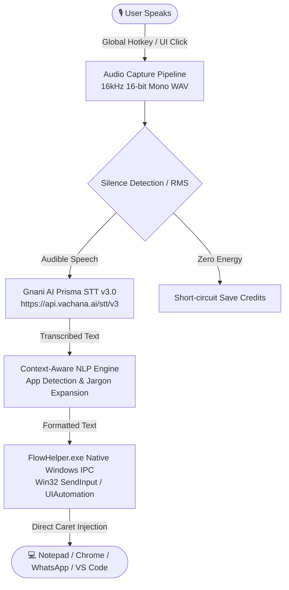

# IndicFlow 🎙️🇮🇳

> **High-Performance System-Wide AI Voice Dictation & Workflow Companion for Windows, natively powered by Gnani AI's Prisma STT v3.0.**

Built for **The Great Indian AI Internship Challenge** by **Gnani AI**.

---

## 🌟 Overview

**IndicFlow** brings seamless, voice-first intelligence directly to any Windows application. Whether you are drafting messages in WhatsApp Web, writing code in VS Code, composing emails in Outlook, or taking notes in Notion, IndicFlow allows you to speak naturally in **English, Hindi, Hinglish, and Indic regional languages**, instantly typing the formatted transcription right at your cursor.

Powered natively by **Gnani AI's Prisma STT (v3.0)** running on the high-performance **Vachana AI Platform** (`api.vachana.ai`), IndicFlow bridges cutting-edge Indian language voice AI with low-latency Windows desktop architecture.

---

## ✨ Key Features

- **🇮🇳 Powered by Gnani AI Prisma STT (v3.0)**:
  - First-class support for **Hinglish** (code-mixed Hindi + English) and auto-detected Indic languages (`indic-auto`).
  - Supports Hindi, Indian English, Telugu, Tamil, Kannada, Marathi, and Bengali.
  - Direct REST integration (`POST /stt/v3`) with sub-second processing latency.
- **🎯 System-Wide Windows Caret Tracking**:
  - A discreet, floating pill HUD dynamically positions itself right next to your active text caret across any application using Windows UI Automation (`UIAutomationCore`).
- **⚡ Global Hotkey & Push-to-Talk**:
  - Native C++ input engine (`FlowHelper.exe`) supporting `Double-tap Fn / CapsLock` or `Ctrl + Space` for zero-lag push-to-talk activation.
- **🧠 Context-Aware Formatting & Command Mode**:
  - Automatically formats spoken speech based on the active application context:
    - **Terminals (pwsh, bash, wt)**: Shell command sanitization, flags (`-m`, `--help`), camelCase and snake_case formatting.
    - **Documents (Word, Outlook)**: Formal capitalization, punctuation, and grammar polish.
    - **Chat (Slack, Discord, WhatsApp)**: Natural conversational flow.
  - **Voice Actions**: Say *"make it bullet points"* or *"translate to Hindi"* to transform text on the fly.
- **📚 Personalization & Custom Jargon Expansion**:
  - Auto-learning user dictionary expands acronyms, technical jargon, and team phrases (e.g., *"k8s"* $\rightarrow$ *"Kubernetes"*).
- **🛡️ 100% Clean-Room Architecture**:
  - Built from scratch with an independent Electron 40 shell, Node.js SQLite (`node:sqlite`) with WAL mode, and lightweight C++ native supervisor.

---

## 🏗️ System Architecture



---

## 🚀 Quick Start

### 1. Prerequisites
- **Windows 10 / 11** (64-bit)
- **Node.js** (v20+ recommended, v24 verified)
- A **Gnani AI API Key** from [app.gnani.ai](https://app.gnani.ai) (5,000 free credits available)

### 2. Installation
```powershell
# Clone the repository
git clone https://github.com/Manoj-Sasanala/IndicFlow.git
cd IndicFlow

# Install dependencies
npm install
```

### 3. Configure Your Gnani API Key
Create a `.env` file in the project root:
```env
GNANI_API_KEY=your_gnani_api_key_here
GNANI_MODEL=prisma-v3.0
GNANI_LANGUAGE=indic-auto
PRIMARY_STT_PROVIDER=gnani_prisma
```
*(You can also configure this directly in the Settings UI inside the app).*

### 4. Run Verification Tests
IndicFlow comes with an exhaustive test suite covering native helper IPC, audio pipelines, SQLite persistence, and Gnani API integration:
```powershell
# Run all tests (53 desktop client tests, 31 AI services tests, 8 integration tests)
npm test

# Test live connection to Gnani AI Prisma STT API
npm run test:gnani
```

### 5. Launch IndicFlow
```powershell
npm start
```
*Or on Windows, simply double-click **`run.bat`**.*
- Open any app (e.g., Notepad, WhatsApp, or Chrome).
- Press your configured hotkey (default: **Double-tap Fn / CapsLock** or click the floating pill).
- Speak in Hindi, Hinglish, or English:
  > *"Kal subah 10 baje team meeting schedule karni hai."*
- Watch IndicFlow transcribe and paste your speech in real time!

---

## 🧪 Test Coverage

| Test Suite | Components Tested | Pass Rate |
| :--- | :--- | :--- |
| **Desktop Client Tests** | Electron window manager, SQLite WAL mode, notes, dictionary, IPC | **53 / 53 PASS** |
| **AI & Audio Services** | 16kHz downsampling, AudioChunker, RMS silence gate, Context Formatter, Command Classifier, Gnani STT provider | **31 / 31 PASS** |
| **E2E Integration** | FlowHelper native IPC, active window caret tracking, end-to-end dictation lifecycle | **8 / 8 PASS** |
| **Gnani Live STT** | Live ping to `api.vachana.ai/stt/v3` with `prisma-v3.0` | **PASS (200 OK)** |

---

## 🛠️ Tech Stack

- **Speech Recognition Engine**: [Gnani AI](https://gnani.ai) Prisma STT v3.0 / Vachana AI REST API
- **Application Shell**: Electron v40.10.2
- **Native OS Layer**: Win32 C++ (`FlowHelper.exe`, Windows UI Automation, Virtual Key Injection)
- **Local Persistence**: `node:sqlite` DatabaseSync with Write-Ahead Logging (WAL)
- **Audio Processing**: High-speed Float32/Int16 PCM streaming buffer, RMS speech detector

---

## 📜 License

This project is licensed under the **MIT License** — see the [LICENSE](LICENSE) file for details.

---

## 🙏 Acknowledgements

- **[Gnani AI](https://gnani.ai)** for providing their state-of-the-art **Prisma STT** voice models and hosting the **Great Indian AI Internship Challenge**.

